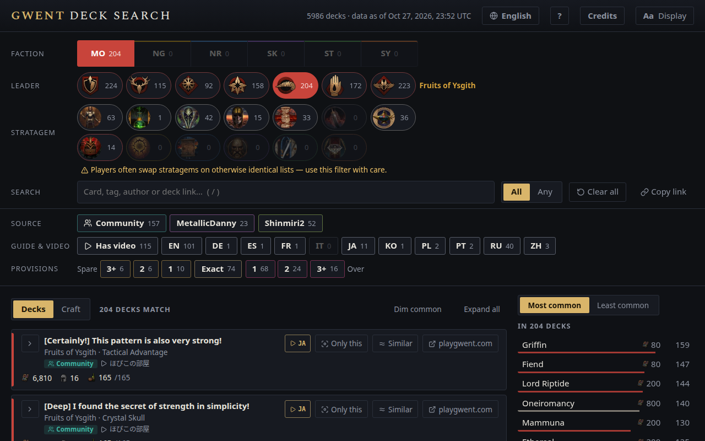

# Gwent Deck Search

**English** · [Deutsch](docs/README.de.md) · [Español](docs/README.es.md) · [Français](docs/README.fr.md) ·
[Italiano](docs/README.it.md) · [日本語](docs/README.ja.md) · [한국어](docs/README.ko.md) · [Polski](docs/README.pl.md) ·
[Português (Brasil)](docs/README.pt-BR.md) · [Русский](docs/README.ru.md) · [简体中文](docs/README.zh-cn.md)

Gwent Deck Search lists published decks for _GWENT: The Witcher Card Game_ and narrows them down as you pick a
faction, a leader and the cards you've seen. Use it during a match to work out what your opponent is playing, or
between matches to find a deck to build.

- **Open it:** <https://el8ted.github.io/gwentdecksearch/>
- **Use it offline:** download the zip from [Releases](https://github.com/el8ted/gwentdecksearch/releases), unzip
  it and open `index.html`. No install, no account.

## Contents

- [Quick start](#quick-start)
- [The page at a glance](#the-page-at-a-glance)
- [Find out what your opponent is playing](#find-out-what-your-opponent-is-playing)
- [Find a deck to build](#find-a-deck-to-build)
- [Read a deck](#read-a-deck)
- [Provisions: Spare, Exact and Over](#provisions-spare-exact-and-over)
- [Filters](#filters)
- [Save and share a search](#save-and-share-a-search)
- [Languages](#languages)
- [Display and accessibility](#display-and-accessibility)
- [Keyboard shortcuts](#keyboard-shortcuts)
- [Common questions](#common-questions)
- [Where the decks come from](#where-the-decks-come-from)
- [Credits](#credits)
- [Contributing](#contributing)
- [License](#license)

## Quick start

1. Pick a **faction**, then a **leader**. In a match, start with your opponent's.
2. Type the cards you see into the **Cards** box (press <kbd>/</kbd> to jump there), or a tag such as Beast or
   Devotion. Each one narrows the list.
3. **Most common** shows the cards the remaining decks run; **Least common** shows rare surprises. Click a card to
   add it.
4. **All** lists decks with every card you've added; **Any** lists decks with at least one, best matches first.
5. Click a deck to see its cards. **↗** opens it on playgwent.com, where you can import it.
6. **Spare** means room to upgrade a card. **Over** means card costs have changed and the deck no longer fits.
7. **Clear all** starts over. Your browser's Back button undoes it.

The same steps are in the page's **?** (Help) panel, with the keyboard shortcuts.

## The page at a glance

| Area | What it's for |
|---|---|
| **Header** | How many decks there are and when the data was collected. Buttons for **Language**, **?** (Help), **Credits** and **Aa Display**. |
| **Filters** | Source, Provisions, Faction, Leader, Stratagem and Cards. Each option shows how many decks match it. |
| **Results** (left) | The matching decks. Click one to open its card list. |
| **Card frequency** (right) | How many of the matching decks run each card you haven't added yet. |

Every option shows a count. An option with **0** is dimmed: picking it would leave no decks.

## Find out what your opponent is playing

The filters follow the order things happen in a match: you see the **leader** first, sometimes the **stratagem**,
then **cards** as they're played.

**1. Pick the faction and leader.** Leaders appear as their ability icons once a faction is picked. Hover over an
icon to see its name; the selected leader's name is shown next to the icons.

**2. Add the cards you see.** Press <kbd>/</kbd> and start typing. Suggestions show each card's provision cost and
how many of the remaining decks run it. Use <kbd>↑</kbd> <kbd>↓</kbd> to move and <kbd>Enter</kbd> to add.

**Authors** too: type a community guide author's playgwent name, or Shinmiri2 or MetallicDanny for their guides and
their lists, to keep their decks. Case and spaces don't matter, and at most three authors are suggested, after the
cards.

**Tags** work the same way: type a category like Beast, Ogroid or Spell, or an ability like Devotion or Order, to
keep the decks with at least one such card. They're the tags of the game's deck builder, one per tag however the card
text words it, so "Orders" or "Beasts" finds the same tag. Only tags some remaining deck has are suggested. A tag
counts as one of your picks for **All** and **Any**, and an expanded deck highlights the cards that carry it.

**3. Check what the remaining decks have in common.** The **Most common** panel counts how many of the matching
decks run each card. A card near the top is likely to show up.

**4. Check for surprises.** **Least common** lists cards only one or two of the matching decks run: tech cards you
might not expect. Click one to see which deck runs it.

> The panel counts decks, not how often a card is drawn. Any card in a deck can be played.

**About stratagems.** Players often swap the stratagem on an otherwise identical list. If you filter by stratagem,
the note under the stratagem icons tells you how many more decks match with a different one, and **Any stratagem**
removes the filter.

## Find a deck to build

Switch **All** to **Any** and add the cards you want to play, own, or have just crafted. You get every deck that
uses at least one of them, with the decks using the most of your cards at the top.

Adding a card that belongs to one faction also picks that faction, if none is picked. Removing the card clears it
again. Neutral cards, and cards that belong to two factions, leave the faction alone. To search across all factions,
click the selected faction to clear it.

## Read a deck

Click a deck's name to open its card list. **Expand all** opens every deck in the results.

| Part | Meaning |
|---|---|
| **Name** | The deck's name, then its leader · stratagem. |
| **Badges** | Which sources list the deck. Community guides also show votes, author and last update. |
| **Language** | The language a community guide is written in, as a short code (**EN**, **RU**, **PL**…). Guides that are only filler ("text text text") show none. It says there's real text, not whether it's useful. Hover for the language's name. |
| **▶** | A gameplay video, with the language it's narrated in (e.g. **▶ RU**): from the guide itself, Shinmiri2's or MetallicDanny's list, or Shinmiri2's YouTube channel. |
| **Deck ID** | The first 8 characters of the playgwent deck code. Two decks with the same name have different IDs. |
| **↗** | Opens the deck on playgwent.com in a new tab, ready to import. |
| **Stats** | Scraps · cards · units · provisions used / limit. |
| **Card list** | Provision cost, power (units only) and copies, highest cost first. Cards you searched for are highlighted. Each card name links to its playgwent card page. |

**Dim common** fades the cards that every deck in the results runs, so the cards that make each deck different stand
out. It's most useful with two or three decks open side by side.

## Provisions: Spare, Exact and Over

Card costs and leader bonuses change every month with the Balance Council, but published decks don't change. A deck
that fitted when it was posted can be over its limit now, or have provisions to spare. Every deck is checked against
today's limit: **150 + the leader's bonus**.

| Badge | Meaning |
|---|---|
| **N spare** | The deck is under the limit: room to upgrade a card. |
| (none) | Exactly on the limit. |
| **+N over** | The deck no longer fits: swap in something cheaper before playing it. |

The **Provisions** filter narrows by how far off a deck is: 3+, 2 or 1 spare, Exact, or 1, 2 or 3+ over. Pick
several to combine them.

## Filters

| Filter | How it works |
|---|---|
| **Source** | Community, MetallicDanny, Shinmiri2. Pick one or more; none picked means every source. |
| **Provisions** | 3+, 2 or 1 spare, Exact, or 1, 2 or 3+ over. Pick one or more; none picked means any. |
| **Guide & video** | **▶ Has video** keeps decks with a gameplay video. A language (**EN**, **RU**, **PL**…) keeps decks whose guide or video is in it (filler guides don't count); pick one or more. Hover for the language's name. |
| **Faction** | One at a time. Click the selected faction again to clear it. |
| **Leader** | Appears once a faction is picked. Click the selected leader again to clear it. Changing faction clears it. |
| **Stratagem** | Neutral stratagems on the first row, faction stratagems on the second. Hover for names. |
| **Cards** | **All**: decks with every card. **Any**: decks with at least one, best matches first. ✕ removes a card. |
| **Clear all** | Resets every filter except All/Any, and turns off Dim common. |

## Save and share a search

Your filters are part of the page address. Bookmark it, share it, or reload the page and your search is still
there. Deck and card links open in a new tab so you don't lose it.

## Languages

The page comes in the 11 languages playgwent supports. Click the language button (🌐) in the header to change it.
Your choice is remembered; on a first visit the page follows your browser's language.

- **Card names and game terms** (factions, Provisions, Stratagem and so on) are playgwent's official names.
- **The rest of the interface** was machine-translated. Corrections are welcome: see [CONTRIBUTING.md](CONTRIBUTING.md).
- **Deck names** are shown as their authors wrote them when they're in your language, and machine-translated into
  English otherwise.
- **The Cards box** finds cards by their name in your language or in English.
- **Shared links** keep the language if `?lang=` is in the address, for example `?lang=ru`.

## Display and accessibility

Open **Aa Display** in the header to change:

- **Text size**: 87.5% to 150%. The whole layout scales.
- **Theme**: System, Dark or Light.
- **Contrast**: Standard or High.
- **Colours**: Standard or Colour-blind safe. Colour-blind safe uses the Okabe–Ito palette and adds a faction label
  to each deck, so colour is never the only cue.

Settings are saved on your device. Filter pills, badges and secondary text meet WCAG AA contrast (4.5:1) in every
theme, contrast and colour setting. Everything works with a keyboard, and animations follow your system's
reduced-motion setting.

## Keyboard shortcuts

Press <kbd>?</kbd> on the page for this list.

| Key | Action |
|---|---|
| <kbd>/</kbd> | Jump to the Cards box |
| <kbd>[</kbd> | Jump to the filters |
| <kbd>]</kbd> | Jump to card frequency (Most/Least common) |
| <kbd>Shift</kbd>+<kbd>Backspace</kbd> | Clear all (the browser's Back undoes it) |
| <kbd>?</kbd> | Show or hide Help |
| <kbd>↑</kbd> <kbd>↓</kbd> or <kbd>Tab</kbd> | Move through card suggestions |
| <kbd>Enter</kbd> | Add the highlighted card |
| <kbd>Backspace</kbd> | Remove the last card (when the Cards box is empty) |
| <kbd>Esc</kbd> | Close suggestions, menus and Help |

Shortcuts work when you aren't typing in a box. On keyboards where <kbd>/</kbd> <kbd>[</kbd> <kbd>]</kbd> are
elsewhere (for example Russian), the keys in the US positions work. Press <kbd>Tab</kbd> at the top of the page for
links that skip to the cards, results or card frequency.

## Common questions

**No decks match.** The filters together are too narrow. Remove the last card you added (✕ on the card), or unpick
a filter. Options that show **0** would leave no decks. **Clear all** starts over.

**I can't find the leader.** Pick a faction first; its leaders then appear as icons.

**A deck I know is missing.** Only decks from the [sources below](#where-the-decks-come-from) are included, and only
recent ones. If a deck should be here, [report it](https://github.com/el8ted/gwentdecksearch/issues/new/choose).

**A deck says "+N over". Is it broken?** No. Card costs changed after it was published. Swap in a cheaper card
before you play it.

**How current is the data?** The header shows when it was collected, in UTC. Gwent updates land around midnight
UTC, so you can tell whether the data is from before or after the latest update.

**A deck name reads oddly.** Names not written in English are machine-translated. You can
[fix them](CONTRIBUTING.md#fixing-deck-name-translations).

## Where the decks come from

| Source | What it is |
|---|---|
| **Community** | Published deck guides on playgwent.com from the last 12 months, in every language, with votes and author. |
| **MetallicDanny** | A Russian-language deck list ([deck list](https://docs.google.com/spreadsheets/d/1_nLQ_0y1t_3zRAwjRSPjSv4djBSRKHPyli3hNrjRgkg/edit?gid=1966172750)), including decks from the last six months of his per-patch meta reports and new-deck lists. Deck names are machine-translated into English, keeping official card names. |
| **Shinmiri2** | A curated list of competitive decks ([deck list](https://docs.google.com/spreadsheets/d/1h4m0zhPOiW2Tyaj26kGIvPdSXgtmgerR5uu7vBHM-BM/edit?gid=1592369710)), including alternate versions and decks from the last six months of per-patch tabs. Alternates appear as separate decks with the same name. |

A deck listed by more than one source appears once, with every source badge. Card lists, costs and card data come
from playgwent.com. Provisions, scraps and card counts are worked out from current card data, so they follow every
Balance Council change.

## Credits

Deck lists belong to their authors: the playgwent.com community, MetallicDanny
([YouTube](https://www.youtube.com/@metallicdanny), [Twitch](https://www.twitch.tv/metallicdanny)) and Shinmiri2
([YouTube](https://www.youtube.com/@shinmiri2101), [Twitch](https://www.twitch.tv/shinmiri2)). The **Credits**
button on the page links to them.

Gwent Deck Search is built and maintained with the help of AI tools, for code and translations. [AI.md](AI.md) lists
the tools and what they're used for.

This is an unofficial fan project, not affiliated with or endorsed by CD PROJEKT RED. GWENT and The Witcher are
trademarks of CD PROJEKT S.A. Card data, art and icons belong to CD PROJEKT S.A. and are used under its
[Fan Content Guidelines](https://www.cdprojektred.com/en/fan-content).

## Contributing

The most useful help is fixing translations, of the interface or of deck names. See [CONTRIBUTING.md](CONTRIBUTING.md).
To report a problem or a missing deck, [open an issue](https://github.com/el8ted/gwentdecksearch/issues/new/choose).

## License

The source code is licensed under the [PolyForm Noncommercial License 1.0.0](LICENSE): you may use, change and share
it for any noncommercial purpose. Commercial use is not permitted.

The license covers the code only, not deck lists or GWENT material. See [NOTICE.md](NOTICE.md).
