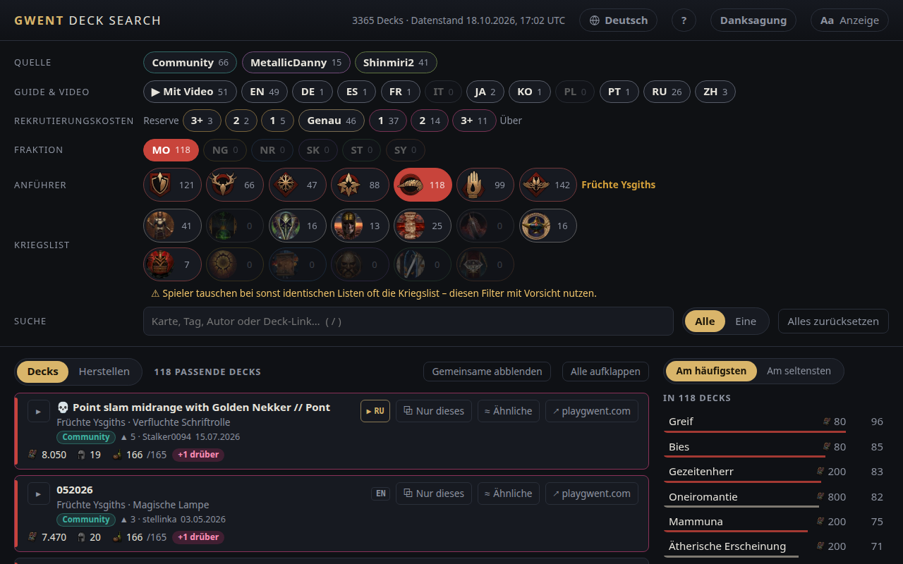

<!-- Generated by scripts/readme-stubs.ts from src/i18n/de.json: edit those, then run `pnpm readmes`. -->

# Gwent Deck Search

[English](../README.md) · **Deutsch** · [Español](README.es.md) · [Français](README.fr.md) · [Italiano](README.it.md) · [日本語](README.ja.md) · [한국어](README.ko.md) · [Polski](README.pl.md) · [Português (Brasil)](README.pt-BR.md) · [Русский](README.ru.md) · [简体中文](README.zh-cn.md)

Gwent Deck Search listet veröffentlichte Decks für GWENT: The Witcher Card Game und grenzt sie ein, während du Fraktion, Anführer und gesehene Karten wählst.

**[Seite auf Deutsch öffnen](https://el8ted.github.io/gwentdecksearch/?lang=de)**

## So geht's

1. Wähle eine Fraktion, dann einen Anführer. Im Match fängst du mit denen deines Gegners an.
2. Gib die Karten, die du siehst, ins Suchfeld ein (Taste /), einen Tag wie Bestie oder Hingabe oder einen Autor. Jeder Eintrag grenzt die Liste ein. Mit - davor schließt du etwas aus.
3. Am häufigsten zeigt Karten, die die übrigen Decks spielen; Am seltensten zeigt seltene Überraschungen. Klicke eine an, um sie hinzuzufügen.
4. Alle listet Decks mit allem, was du hinzugefügt hast; Eine listet Decks mit mindestens einem Eintrag, beste Treffer zuerst.
5. Klicke ein Deck an, um seine Karten zu sehen. ↗ öffnet es zum Importieren auf playgwent.com; ▶ spielt ein Gameplay-Video ab, wenn es eines gibt. ⧉ zeigt nur dieses Deck, als hättest du seinen Link eingefügt.
6. Herstellen, neben Decks, listet die Karten der passenden Decks und ihre Herstellungskosten: ein Hinweis, wofür sich deine Scraps lohnen.
7. Reserve: Platz, um eine Karte aufzuwerten. Über: Die Kosten haben sich geändert und das Deck passt nicht mehr.
8. Alles zurücksetzen fängt neu an; die Zurück-Taste deines Browsers macht es rückgängig.

Die vollständige Anleitung gibt es auf Englisch: [guide.md](guide.md)

> Diese Seite wurde maschinell übersetzt. Korrekturen sind willkommen: [CONTRIBUTING.md](../CONTRIBUTING.md)
