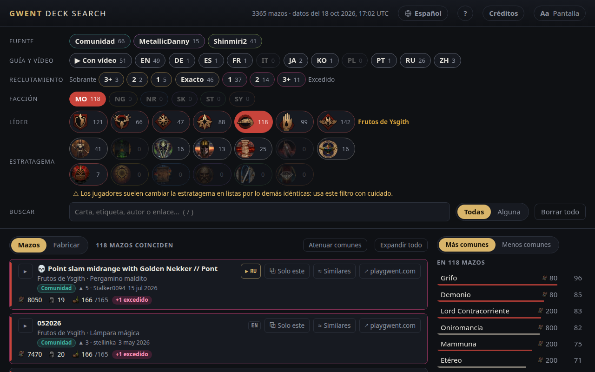

<!-- Generated by scripts/readme-stubs.ts from src/i18n/es.json: edit those, then run `pnpm readmes`. -->

# Gwent Deck Search

[English](../README.md) · [Deutsch](README.de.md) · **Español** · [Français](README.fr.md) · [Italiano](README.it.md) · [日本語](README.ja.md) · [한국어](README.ko.md) · [Polski](README.pl.md) · [Português (Brasil)](README.pt-BR.md) · [Русский](README.ru.md) · [简体中文](README.zh-cn.md)

Gwent Deck Search lista los mazos publicados de GWENT: The Witcher Card Game y los filtra a medida que eliges facción, líder y las cartas que has visto.

**[Abrir el sitio en español](https://el8ted.github.io/gwentdecksearch/?lang=es)**

## Cómo se usa

1. Elige una facción y luego un líder. En una partida, empieza por los de tu rival.
2. Escribe en el cuadro Buscar las cartas que veas (pulsa /), una etiqueta como Bestia o Devoción, o un autor. Cada una reduce la lista. Escribe - delante para excluir algo.
3. Más comunes muestra las cartas que llevan los mazos restantes; Menos comunes muestra sorpresas poco habituales. Haz clic en una para añadirla.
4. Todas lista los mazos con todo lo que has añadido; Alguna, los que tienen al menos una cosa, con las mejores coincidencias primero.
5. Haz clic en un mazo para ver sus cartas. ↗ lo abre en playgwent.com para importarlo; ▶ reproduce un vídeo de partidas, si lo hay. ⧉ muestra solo ese mazo, como si hubieras pegado su enlace.
6. Fabricar, junto a Mazos, muestra las cartas de los mazos que coinciden y lo que cuesta fabricarlas: una guía para gastar tus restos.
7. Sobrante: espacio para mejorar una carta. Excedido: los costes han cambiado y el mazo ya no cabe.
8. Borrar todo empieza de nuevo; el botón Atrás del navegador lo deshace.

La guía completa está en inglés: [guide.md](guide.md)

> Esta página se tradujo automáticamente. Las correcciones son bienvenidas: [CONTRIBUTING.md](../CONTRIBUTING.md)
