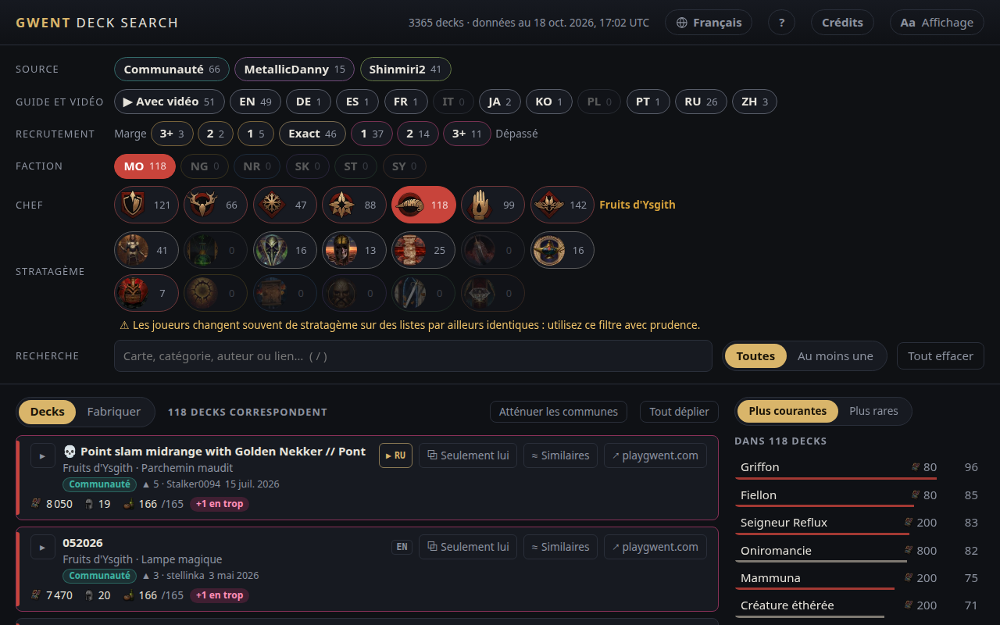

<!-- Generated by scripts/readme-stubs.ts from src/i18n/fr.json: edit those, then run `pnpm readmes`. -->

# Gwent Deck Search

[English](../README.md) · [Deutsch](README.de.md) · [Español](README.es.md) · **Français** · [Italiano](README.it.md) · [日本語](README.ja.md) · [한국어](README.ko.md) · [Polski](README.pl.md) · [Português (Brasil)](README.pt-BR.md) · [Русский](README.ru.md) · [简体中文](README.zh-cn.md)

Gwent Deck Search liste les decks publiés de GWENT: The Witcher Card Game et les filtre à mesure que vous choisissez une faction, un chef et les cartes que vous avez vues.

**[Ouvrir le site en français](https://el8ted.github.io/gwentdecksearch/?lang=fr)**

## Mode d'emploi

1. Choisissez une faction, puis un chef. En partie, commencez par ceux de votre adversaire.
2. Tapez les cartes que vous voyez dans la zone Cartes (touche /), ou une catégorie comme Bête ou Dévotion. Chacune réduit la liste.
3. Plus courantes montre les cartes jouées par les decks restants ; Plus rares montre les surprises peu fréquentes. Cliquez sur une carte pour l'ajouter.
4. Toutes liste les decks contenant chaque carte ; Au moins une liste ceux qui en contiennent au moins une, meilleures correspondances d'abord.
5. Cliquez sur un deck pour voir ses cartes. ↗ l'ouvre sur playgwent.com pour l'importer.
6. Marge : de la place pour améliorer une carte. Dépassé : les coûts ont changé et le deck ne rentre plus.
7. Tout effacer repart de zéro ; le bouton Retour du navigateur l'annule.

Le guide complet est en anglais: [README.md](../README.md)

> Cette page a été traduite automatiquement. Les corrections sont les bienvenues : [CONTRIBUTING.md](../CONTRIBUTING.md)
