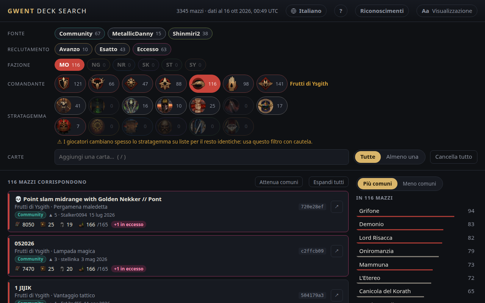

<!-- Generated by scripts/readme-stubs.ts from src/i18n/it.json: edit those, then run `pnpm readmes`. -->

# Gwent Deck Search

[English](../README.md) · [Deutsch](README.de.md) · [Español](README.es.md) · [Français](README.fr.md) · **Italiano** · [日本語](README.ja.md) · [한국어](README.ko.md) · [Polski](README.pl.md) · [Português (Brasil)](README.pt-BR.md) · [Русский](README.ru.md) · [简体中文](README.zh-cn.md)

Gwent Deck Search elenca i mazzi pubblicati di GWENT: The Witcher Card Game e li restringe mentre scegli fazione, comandante e le carte che hai visto.

**[Apri il sito in italiano](https://el8ted.github.io/gwentdecksearch/?lang=it)**

## Come si usa

1. Scegli una fazione, poi un comandante. In partita, parti da quelli dell'avversario.
2. Scrivi nel campo Cerca le carte che vedi (tasto /), un tag come Bestia o Devozione, oppure un autore. Ognuno restringe l'elenco. Scrivi - davanti per escludere.
3. Più comuni mostra le carte usate dai mazzi rimasti; Meno comuni mostra le sorprese rare. Fai clic su una carta per aggiungerla.
4. Tutte elenca i mazzi con tutto ciò che hai aggiunto; Almeno una quelli con almeno un elemento, migliori corrispondenze prima.
5. Fai clic su un mazzo per vederne le carte. ↗ lo apre su playgwent.com per importarlo; ▶ avvia un video di gameplay, se c'è. ⧉ mostra solo quel mazzo, come se avessi incollato il suo link.
6. Avanzo: spazio per migliorare una carta. Eccesso: i costi sono cambiati e il mazzo non rientra più.
7. Cancella tutto ricomincia da capo; il tasto Indietro del browser lo annulla.

La guida completa è in inglese: [guide.md](guide.md)

> Questa pagina è stata tradotta automaticamente. Le correzioni sono benvenute: [CONTRIBUTING.md](../CONTRIBUTING.md)
