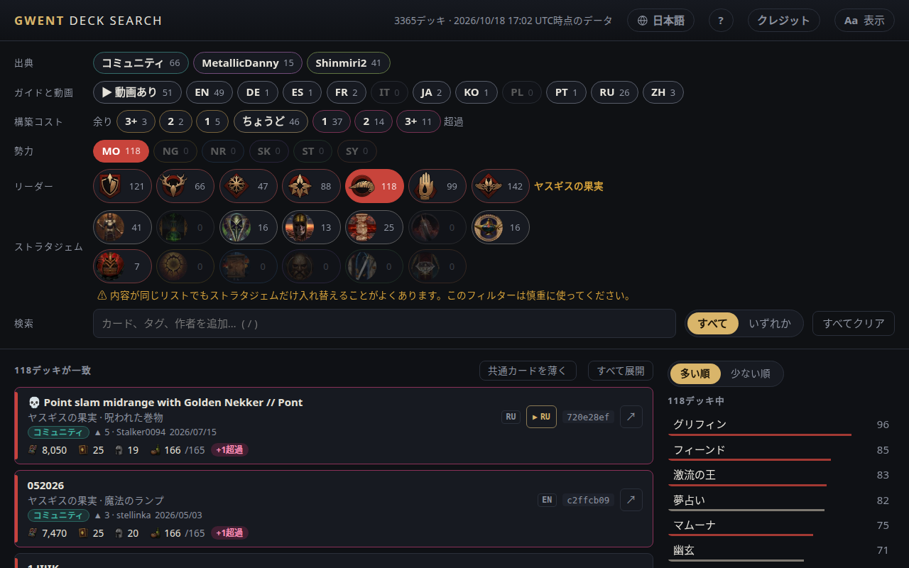

<!-- Generated by scripts/readme-stubs.ts from src/i18n/ja.json: edit those, then run `pnpm readmes`. -->

# Gwent Deck Search

[English](../README.md) · [Deutsch](README.de.md) · [Español](README.es.md) · [Français](README.fr.md) · [Italiano](README.it.md) · **日本語** · [한국어](README.ko.md) · [Polski](README.pl.md) · [Português (Brasil)](README.pt-BR.md) · [Русский](README.ru.md) · [简体中文](README.zh-cn.md)

Gwent Deck Search は「グウェント ウィッチャーカードゲーム」の公開デッキを一覧にし、勢力・リーダー・見たカードを選ぶたびに絞り込みます。

**[日本語でサイトを開く](https://el8ted.github.io/gwentdecksearch/?lang=ja)**

## 使い方

1. 勢力を選び、次にリーダーを選びます。対戦中は相手のものから始めましょう。
2. 見たカードを検索欄に入力します（/ キー）。野獣や献身などのタグ、作者名も入力できます。追加するたびにリストが絞り込まれます。
3. 多い順は残りのデッキが採用しているカード、少ない順は珍しいカードを表示します。クリックで追加できます。
4. すべては追加したものをすべて含むデッキ、いずれかは1つ以上含むデッキを一致数の多い順に表示します。
5. デッキをクリックするとカードが表示されます。↗ で playgwent.com を開いてインポートできます。プレイ動画がある場合は ▶ で再生できます。
6. 余り：カードをアップグレードする余地があります。超過：コストが変わり、デッキが上限を超えています。
7. すべてクリアで最初からやり直せます。ブラウザの「戻る」で元に戻せます。

詳しいガイドは英語です: [README.md](../README.md)

> このページは機械翻訳です。修正を歓迎します： [CONTRIBUTING.md](../CONTRIBUTING.md)
