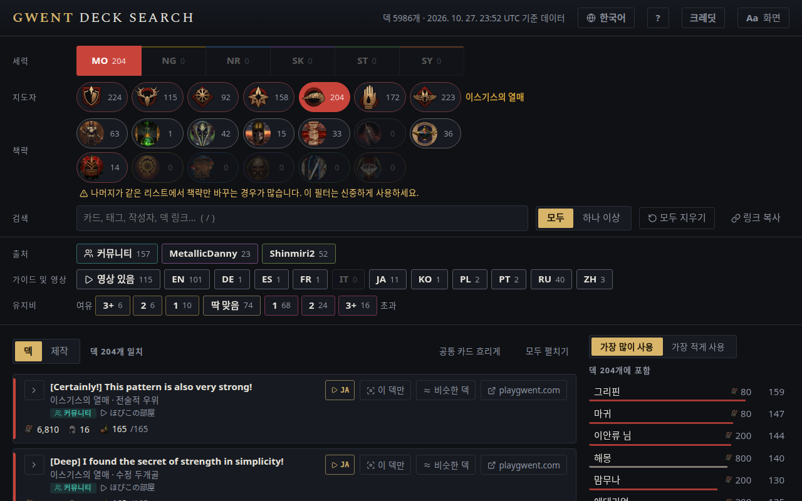

<!-- Generated by scripts/readme-stubs.ts from src/i18n/ko.json: edit those, then run `pnpm readmes`. -->

# Gwent Deck Search

[English](../README.md) · [Deutsch](README.de.md) · [Español](README.es.md) · [Français](README.fr.md) · [Italiano](README.it.md) · [日本語](README.ja.md) · **한국어** · [Polski](README.pl.md) · [Português (Brasil)](README.pt-BR.md) · [Русский](README.ru.md) · [简体中文](README.zh-cn.md)

Gwent Deck Search는 궨트: 더 위쳐 카드 게임의 공개 덱을 보여 주고, 세력·지도자·본 카드를 고를 때마다 목록을 좁혀 줍니다.

**[한국어로 사이트 열기](https://el8ted.github.io/gwentdecksearch/?lang=ko)**

## 사용 방법

1. 세력을 고른 다음 지도자를 고르세요. 대전 중에는 상대의 것부터 고르세요.
2. 본 카드를 검색 칸에 입력하세요(/ 키). 야수나 헌신 같은 태그나 작성자도 입력할 수 있습니다. 추가할 때마다 목록이 좁혀집니다. 앞에 - 기호를 붙이면 제외합니다.
3. 가장 많이 사용은 남은 덱들이 쓰는 카드를, 가장 적게 사용은 드문 깜짝 카드를 보여 줍니다. 클릭하면 추가됩니다.
4. 모두는 추가한 항목을 모두 포함한 덱을, 하나 이상은 하나라도 포함한 덱을 일치가 많은 순으로 보여 줍니다.
5. 덱을 클릭하면 카드가 표시됩니다. ↗는 playgwent.com에서 열어 가져올 수 있고, 플레이 영상이 있으면 ▶로 볼 수 있습니다. ⧉는 링크를 붙여 넣은 것처럼 그 덱만 보여 줍니다.
6. 여유: 카드를 업그레이드할 여지가 있습니다. 초과: 비용이 바뀌어 덱이 한도를 넘습니다.
7. 모두 지우기로 처음부터 다시 시작합니다. 브라우저의 뒤로 버튼으로 되돌릴 수 있습니다.

전체 안내는 영어로 되어 있습니다: [guide.md](guide.md)

> 이 페이지는 기계 번역되었습니다. 수정은 언제나 환영합니다: [CONTRIBUTING.md](../CONTRIBUTING.md)
