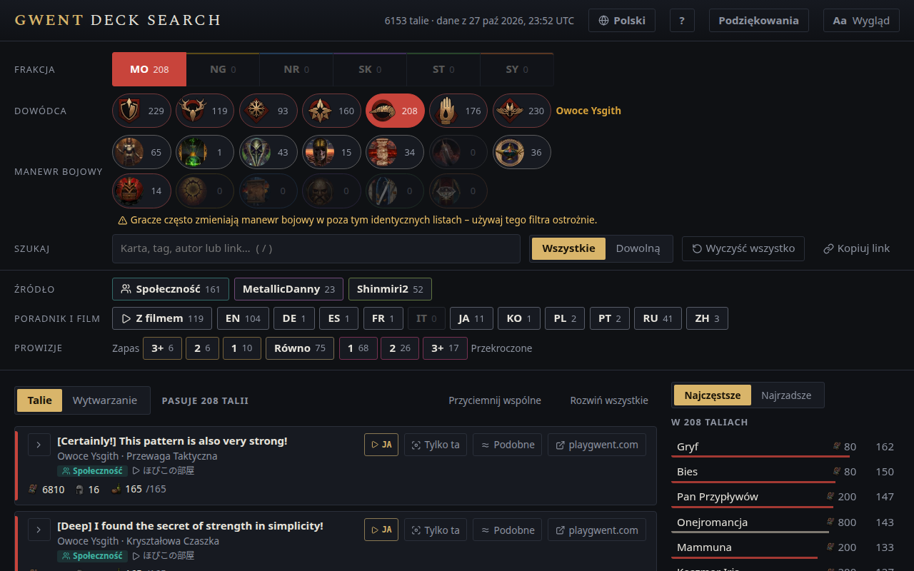

<!-- Generated by scripts/readme-stubs.ts from src/i18n/pl.json: edit those, then run `pnpm readmes`. -->

# Gwent Deck Search

[English](../README.md) · [Deutsch](README.de.md) · [Español](README.es.md) · [Français](README.fr.md) · [Italiano](README.it.md) · [日本語](README.ja.md) · [한국어](README.ko.md) · **Polski** · [Português (Brasil)](README.pt-BR.md) · [Русский](README.ru.md) · [简体中文](README.zh-cn.md)

Gwent Deck Search wyświetla opublikowane talie do GWINT: Wiedźmińska Gra Karciana i zawęża je, gdy wybierasz frakcję, dowódcę i widziane karty.

**[Otwórz stronę po polsku](https://el8ted.github.io/gwentdecksearch/?lang=pl)**

## Jak korzystać

1. Wybierz frakcję, potem dowódcę. W trakcie meczu zacznij od tych, których używa przeciwnik.
2. Wpisz widziane karty w pole Karty (klawisz /) albo tag, np. Bestia lub Lojalność. Każdy wpis zawęża listę.
3. Najczęstsze pokazuje karty grane przez pozostałe talie; Najrzadsze pokazuje rzadkie niespodzianki. Kliknij kartę, aby ją dodać.
4. Wszystkie pokazuje talie z każdą kartą; Dowolną pokazuje talie z co najmniej jedną, najlepsze dopasowania najpierw.
5. Kliknij talię, aby zobaczyć jej karty. ↗ otwiera ją na playgwent.com do zaimportowania.
6. Zapas: miejsce na ulepszenie karty. Przekroczone: koszty się zmieniły i talia już się nie mieści.
7. Wyczyść wszystko zaczyna od nowa; przycisk Wstecz w przeglądarce to cofa.

Pełny przewodnik jest po angielsku: [README.md](../README.md)

> Ta strona została przetłumaczona maszynowo. Poprawki są mile widziane: [CONTRIBUTING.md](../CONTRIBUTING.md)
