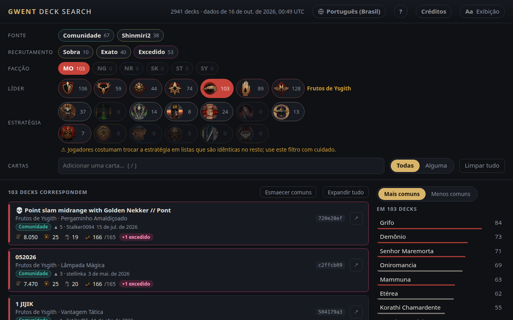

<!-- Generated by scripts/readme-stubs.ts from src/i18n/pt-BR.json: edit those, then run `pnpm readmes`. -->

# Gwent Deck Search

[English](../README.md) · [Deutsch](README.de.md) · [Español](README.es.md) · [Français](README.fr.md) · [Italiano](README.it.md) · [日本語](README.ja.md) · [한국어](README.ko.md) · [Polski](README.pl.md) · **Português (Brasil)** · [Русский](README.ru.md) · [简体中文](README.zh-cn.md)

O Gwent Deck Search lista os decks publicados de GWENT: The Witcher Card Game e os filtra conforme você escolhe facção, líder e as cartas que viu.

**[Abrir o site em português](https://el8ted.github.io/gwentdecksearch/?lang=pt-BR)**

## Como usar

1. Escolha uma facção e depois um líder. Numa partida, comece pelos do seu oponente.
2. Digite as cartas que você vê no campo Cartas (tecla /). Cada uma reduz a lista.
3. Mais comuns mostra as cartas que os decks restantes usam; Menos comuns mostra surpresas raras. Clique numa carta para adicioná-la.
4. Todas lista os decks com todas as cartas; Alguma lista os que têm pelo menos uma, com as melhores correspondências primeiro.
5. Clique num deck para ver as cartas. ↗ abre no playgwent.com para importar.
6. Sobra: espaço para melhorar uma carta. Excedido: os custos mudaram e o deck não cabe mais.
7. Limpar tudo recomeça; o botão Voltar do navegador desfaz.

O guia completo está em inglês: [README.md](../README.md)

> Esta página foi traduzida automaticamente. Correções são bem-vindas: [CONTRIBUTING.md](../CONTRIBUTING.md)
