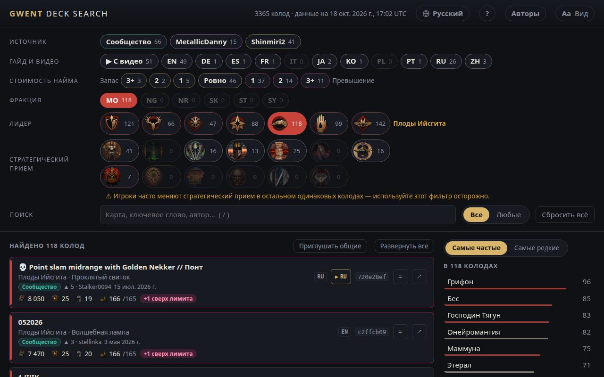

<!-- Generated by scripts/readme-stubs.ts from src/i18n/ru.json: edit those, then run `pnpm readmes`. -->

# Gwent Deck Search

[English](../README.md) · [Deutsch](README.de.md) · [Español](README.es.md) · [Français](README.fr.md) · [Italiano](README.it.md) · [日本語](README.ja.md) · [한국어](README.ko.md) · [Polski](README.pl.md) · [Português (Brasil)](README.pt-BR.md) · **Русский** · [简体中文](README.zh-cn.md)

Gwent Deck Search показывает опубликованные колоды для ГВИНТ: Ведьмак. Карточная игра и сужает список по мере того, как вы выбираете фракцию, лидера и увиденные карты.

**[Открыть сайт на русском](https://el8ted.github.io/gwentdecksearch/?lang=ru)**

## Как пользоваться

1. Выберите фракцию, затем лидера. Во время матча начните с фракции и лидера соперника.
2. Вводите увиденные карты в поле «Поиск» (клавиша /), ключевое слово, например «Зверь» или «Преданность», или автора. Каждое сужает список. Введите - в начале, чтобы исключить.
3. «Самые частые» показывает карты, которые играют оставшиеся колоды; «Самые редкие» — редкие сюрпризы. Нажмите на карту, чтобы добавить её.
4. «Все» — колоды со всем, что вы добавили; «Любые» — колоды хотя бы с одним из этого, лучшие совпадения сверху.
5. Нажмите на колоду, чтобы увидеть её карты. ↗ открывает её на playgwent.com для импорта; ▶ — видео игры колодой, если оно есть.
6. «Запас» — есть место, чтобы улучшить карту. «Превышение» — стоимость изменилась, и колода больше не укладывается в лимит.
7. «Сбросить всё» начинает заново; кнопка «Назад» в браузере отменяет сброс.

Полное руководство — на английском: [guide.md](guide.md)

> Эта страница переведена автоматически. Исправления приветствуются: [CONTRIBUTING.md](../CONTRIBUTING.md)
