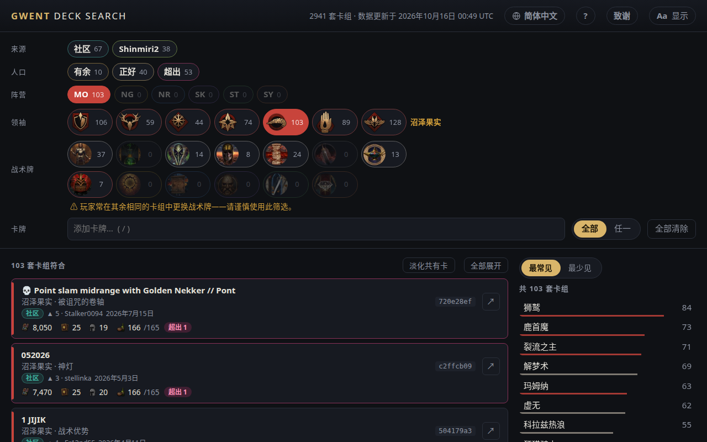

<!-- Generated by scripts/readme-stubs.ts from src/i18n/zh-cn.json: edit those, then run `pnpm readmes`. -->

# Gwent Deck Search

[English](../README.md) · [Deutsch](README.de.md) · [Español](README.es.md) · [Français](README.fr.md) · [Italiano](README.it.md) · [日本語](README.ja.md) · [한국어](README.ko.md) · [Polski](README.pl.md) · [Português (Brasil)](README.pt-BR.md) · [Русский](README.ru.md) · **简体中文**

Gwent Deck Search 列出《巫师之昆特牌》的已发布卡组，并随着你选择阵营、领袖和看到的卡牌逐步缩小范围。

**[用简体中文打开网站](https://el8ted.github.io/gwentdecksearch/?lang=zh-cn)**

## 使用方法

1. 先选择阵营，再选择领袖。对局中，从对手的阵营和领袖开始。
2. 在卡牌框中输入你看到的卡牌（按 /）。每添加一张，列表就会缩小。
3. 最常见显示剩余卡组常用的卡牌；最少见显示少见的奇招。点击卡牌即可添加。
4. 全部列出包含所有卡牌的卡组；任一列出至少包含一张的卡组，匹配最多的排在前面。
5. 点击卡组查看卡牌。↗ 在 playgwent.com 打开以便导入。
6. 有余：还有升级卡牌的空间。超出：费用已变动，卡组超出上限。
7. 全部清除可重新开始；浏览器的后退按钮可撤销。

完整指南为英文: [README.md](../README.md)

> 本页为机器翻译，欢迎指正： [CONTRIBUTING.md](../CONTRIBUTING.md)
