# Gwent Deck Search: The Full Guide

New here? The [Quick start](../README.md#quick-start) covers the basics, and the page's **?** (Help) panel has the
same tips in your language. This guide has three walkthroughs, one for each job the page does, then a reference to
every control.

## Contents

- [During a match](#during-a-match): work out what your opponent is playing
- [Find a deck to play](#find-a-deck-to-play): from a link, cards you like, a creator, or a deck that needs fixing
- [Plan your crafting](#plan-your-crafting): which cards today's decks run, and how far your scraps go
- [Reference](#reference): [Search](#search), [Card frequency](#card-frequency), [Filters](#filters),
  [Provisions](#provisions-spare-exact-and-over), [Read a deck](#read-a-deck), [Dim common](#dim-common),
  [`≈` Similar decks](#-similar-decks), [Craft](#craft), [Save and share](#save-and-share-a-search), [Languages](#languages),
  [Display](#display-and-accessibility), [Keyboard shortcuts](#keyboard-shortcuts)
- [Common questions](#common-questions)

## During a match

You're working out your opponent's archetype, so you can guess the cards still to come, and, once only a few decks
are left, spot the surprise cards one of them might run. It's a loop: one card in, read the result, repeat.

1. **Pick their faction, then their leader.** Leaders appear as icons once a faction is picked. Add the stratagem
   only with care: players swap it freely on otherwise identical lists.
2. **Add the card they just played.** Press <kbd>/</kbd>, type a few letters, <kbd>Enter</kbd>.
3. **Read the count** in the results heading. It tells you what to look at:
   - **Many decks:** **Most common** shows what the remaining decks run, which is the archetype taking shape.
     **Least common** shows the tech cards only a few of them run.
   - **A handful:** **Expand all**, then **Dim common**. What stays bright is what sets each deck apart: that's where
     the surprises are.
4. **Next card: back to step 2.**

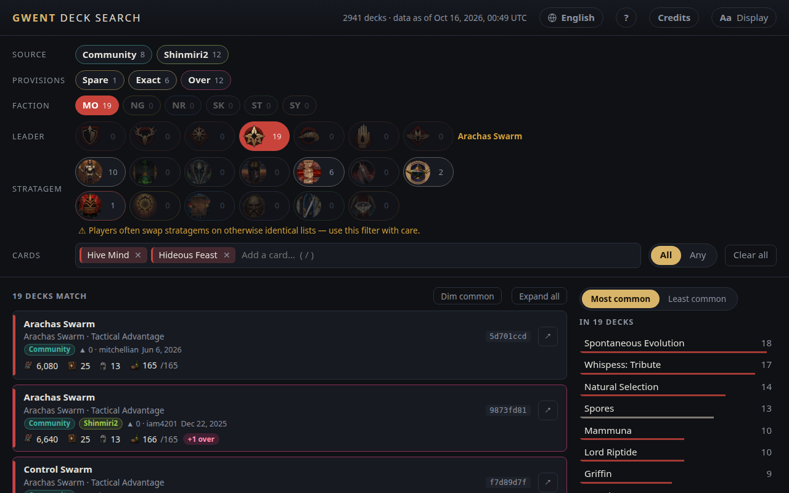

**Probe a guess.** Expect a card next? Add it and read the count. A big drop says it's unlikely; then
<kbd>Backspace</kbd> takes it out again.

**Certain a card isn't in their deck?** You can [exclude it](#search), but only when you're sure: a card they
haven't played yet can still be in the deck.

## Find a deck to play

Where you start depends on what you have in hand; after that, every search goes the same way.

### Where are you starting?

| You have | First move |
|---|---|
| **A deck link** | Paste it into Search. See [Have a deck link?](#have-a-deck-link) below. |
| **Cards or tags you like** | Add them in Search. Switch to **Any** to see decks with at least one of them, best matches first. |
| **Cards you'd rather not play** | Type `-` before a name: `-golden` leaves out every Golden Nekker deck. |
| **A faction and leader in mind** | Pick them, then look at **Most common** for the usual cards. |
| **A favourite creator** | Type their name in Search (**✎**), or pick their list under **Source**. |
| **Time to play, not build** | **▶ Has video** and the **Spare** and **Exact** steps: decks that fit today, with a video. Add your language if you like, but [other languages can still help](#common-questions). |

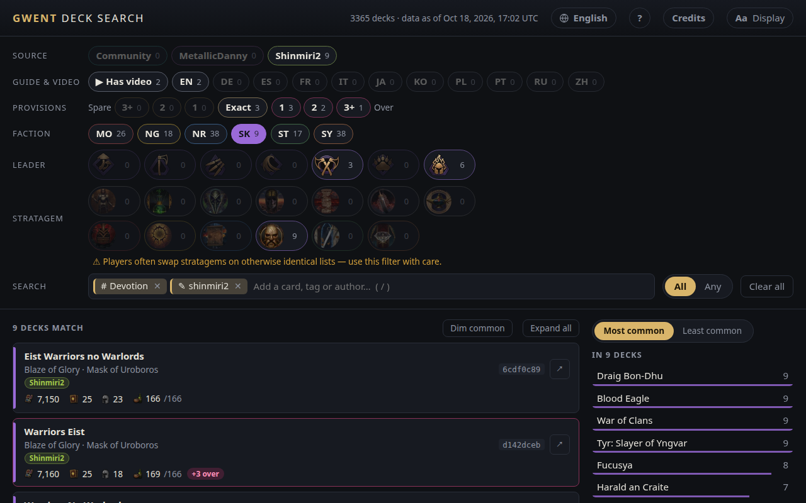

### Then: narrow, inspect, fix, compare

1. **Narrow.** Add what you want and `-` what you don't, until the list is short. **Most common** and **Least common**
   suggest cards to try: click one to add it.
2. **Inspect.** **Expand all** opens every deck; **Dim common** fades what they share, so each deck's choices stand
   out.
3. **Fix provisions.** A **+N over** badge means costs changed since it was posted. Turn on the **Spare** and
   **Exact** steps to see only decks that fit, or use `≈` on an Over deck to find the closest ones that do.
4. **Compare.** `≈` on a deck you like lists its closest relatives, with it first as **This deck**. **Show changes**
   marks what each one added and swapped out.

### Have a deck link?

Paste a playgwent.com deck or guide link into Search. It replaces your other filters (Back brings them back) and shows
that deck, with its guide and video. From there:

- **Read the guide or watch the video:** the links are on the deck.
- **It's over its provisions:** `≈` finds the closest decks that fit.
- **You're tired of it, but like the cards:** `≈` finds variations.

A link to a deck that isn't in the list says so.

## Plan your crafting

New, or back after a break, and not sure where to spend your scraps? **Craft** shows what the decks people publish
today actually run.

Treat it as guidance, not a guarantee. A card many decks run is a safe craft because it fits a lot of decks, but
that doesn't make it the right craft for you: the decks you enjoy, the cards you already have and the next Balance
Council change all matter more than a percentage.

1. **Switch to Craft** above the results. With no filters, the top of the list is the neutral staples every faction
   plays, such as Oneiromancy and Royal Decree: they pay off whatever you end up playing.
2. **Narrow it** with the filters you'd use for decks: a faction, a leader, a card you already have. The list follows
   them, so it shows what *those* decks need.
3. **Type the scraps you have** (the game shows your total). A line marks how far down the list they go.
4. **Tick Have it** on the cards you already own. They stay in place but drop out of the total, so the line moves
   down. Ticks and scraps last until you reload; nothing is saved.
5. **Click a card** to see the decks that run it, and Back to return.

> Craft counts published decks, not ladder play or win rates, and older and alternate versions of a deck count too.
> It shows what's popular among deck builders, which is a good starting point, not proof that a card wins games.

## Reference

### The page at a glance

| Area | What it's for |
|---|---|
| **Header** | How many decks there are and when the data was collected. Buttons for **Language**, **?** (Help), **Credits** and **Aa Display**. |
| **Filters** | Source, Guide & video, Provisions, Faction, Leader, Stratagem and Search. Each option shows how many decks match it. |
| **Results** (left) | The matching decks. Click one to open its card list. |
| **Card frequency** (right) | How many of the matching decks run each card you haven't added yet. |

Every option shows a count. An option with **0** is dimmed: picking it would leave no decks.

### Search

Press <kbd>/</kbd> and start typing in the **Search** box. Suggestions show each card's provision cost and how many of
the remaining decks run it. Use <kbd>↑</kbd> <kbd>↓</kbd> to move and <kbd>Enter</kbd> to add.

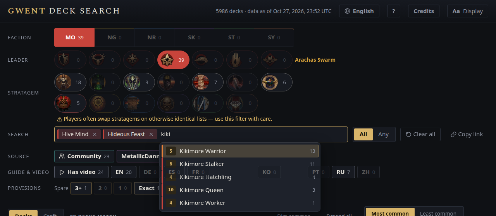

The Search box finds two more kinds of pick, shown after the cards:

- **Tags** (**#**): a category like Beast, Ogroid or Spell, or an ability like Devotion or Order, keeps the decks with
  at least one such card. They're the tags of the game's deck builder, one per tag however the card text words it, so
  "Orders" or "Beasts" finds the same tag. An expanded deck highlights the cards that carry it.
- **Authors** (**✎**): a community guide author's playgwent name keeps their decks. Shinmiri2 and MetallicDanny also
  find their deck lists. Case and spaces don't matter, and at most three authors are suggested.

Only tags and authors that some remaining deck has are suggested. Every pick counts for **All** and **Any**, and picks
stay in the order you added them, so <kbd>Backspace</kbd> in the empty box removes the latest.

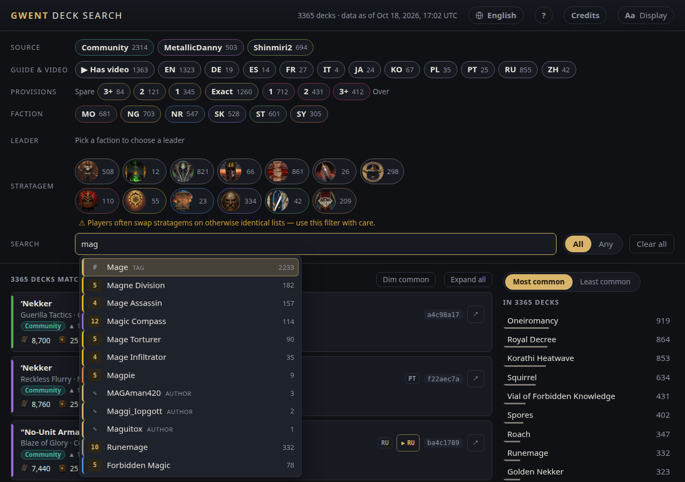

**All and Any.** **All** (the default) lists decks with every pick. **Any** lists decks with at least one, the decks
using the most of your picks at the top: add the cards you want to play, own, or have just crafted, and see what's out
there.

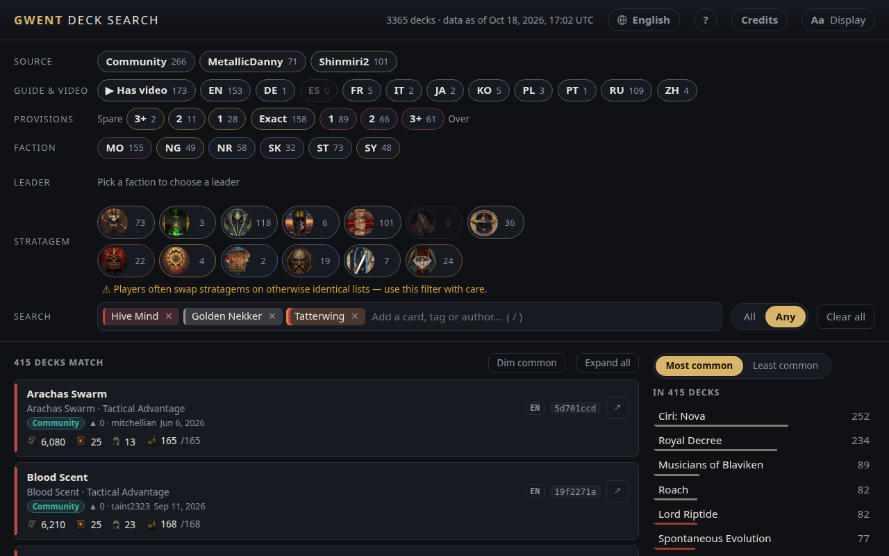

Adding a card that belongs to one faction also picks that faction, if none is picked. Removing the card clears it
again. Neutral cards, and cards that belong to two factions, leave the faction alone. To search across all factions,
click the selected faction to clear it.

**Leave out what you don't want.** Type `-` before a name (or `!`, or the full-width `－` `！` on Japanese, Chinese and
Korean keyboards) and the suggestions turn into **Without** suggestions, each with the number of decks that would
remain. Not a fan of Golden Nekker? `-golden` leaves out every deck that runs it. It works the same for cards you
haven't crafted, tags such as Spying, and authors. You can also click the name of anything you've already added to
exclude it, and click again to want it back. An excluded pick looks faded and struck through. Exclusions always apply:
**All** and **Any** only decide how the remaining picks combine. In a shared link an excluded pick has a `-` in front,
for example Skellige Warrior decks without Tyr:
[`#f=SK&c=c86,-203194`](https://el8ted.github.io/gwentdecksearch/#f=SK&c=c86,-203194).

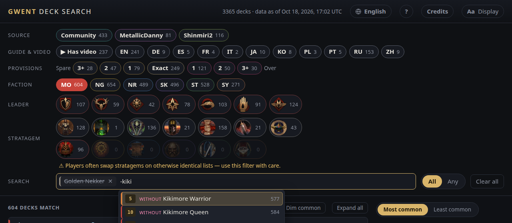

**Deck links.** Paste a playgwent.com deck or guide link to find that deck, with its guide and video. It replaces your
other filters, and Back brings them back. A link to a deck that isn't in the list says so.

### Card frequency

The panel on the right counts how many of the matching decks run each card you haven't added. **Most common** puts
the staples first; **Least common** puts the cards only one or two decks run: tech cards you might not expect. Click
one to add it, or to see which deck runs it. Each card shows what it costs to craft, in scraps; hover over it for its
rarity.

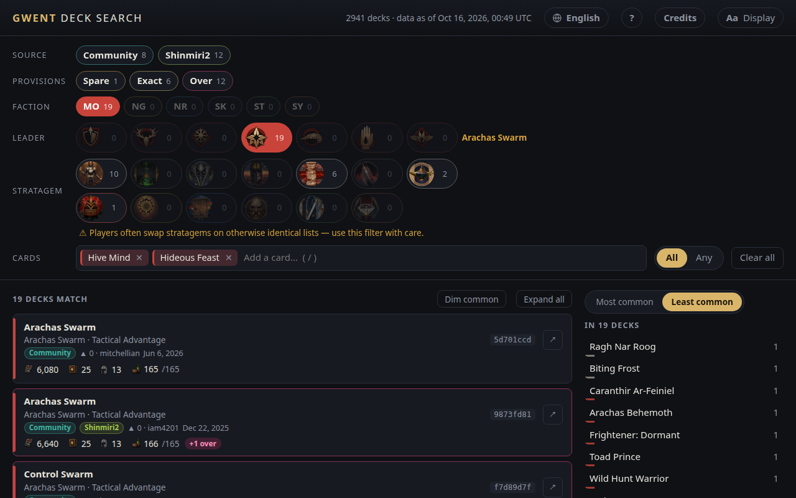

> The panel counts decks, not how often a card is drawn. Any card in a deck can be played.

### Filters

| Filter | How it works |
|---|---|
| **Source** | Community, MetallicDanny, Shinmiri2. Pick one or more; none picked means every source. |
| **Provisions** | 3+, 2 or 1 spare, Exact, or 1, 2 or 3+ over. Pick one or more; none picked means any. |
| **Guide & video** | **▶ Has video** keeps decks with a gameplay video. A language (**EN**, **RU**, **PL**…) keeps decks whose guide or video is in it (filler guides don't count); pick one or more. Hover for the language's name. |
| **Faction** | One at a time. Click the selected faction again to clear it. |
| **Leader** | Appears once a faction is picked. Click the selected leader again to clear it. Changing faction clears it. |
| **Stratagem** | Neutral stratagems on the first row, faction stratagems on the second. Hover for names. |
| **Search** | Cards, tags (**#**) and authors (**✎**). **All**: decks with every pick. **Any**: decks with at least one, best matches first. Click a pick's name to exclude it (struck through: decks *without* it, in All and Any mode alike), or type `-` (or `!`) before a name to add it excluded. ✕ removes a pick. Paste a playgwent.com deck link (a guide or a deck) to find that deck, with its guide and video; this replaces your other filters, and Back brings them back. |
| **Clear all** | Resets every filter except All/Any and the Decks/Craft view, empties the Search box, and turns off Dim common. |

**About stratagems.** Players often swap the stratagem on an otherwise identical list. If you filter by stratagem,
the note under the stratagem icons tells you how many more decks match with a different one, and **Any stratagem**
removes the filter.

### Provisions: Spare, Exact and Over

Card costs and leader bonuses change every month with the Balance Council, but published decks don't change. A deck
that fitted when it was posted can be over its limit now, or have provisions to spare. Every deck is checked against
today's limit: **150 + the leader's bonus**.

| Badge | Meaning |
|---|---|
| **N spare** | The deck is under the limit: room to upgrade a card. |
| (none) | Exactly on the limit. |
| **+N over** | The deck no longer fits: swap in something cheaper before playing it. |

The **Provisions** filter narrows by how far off a deck is: 3+, 2 or 1 spare, Exact, or 1, 2 or 3+ over. Pick
several to combine them.

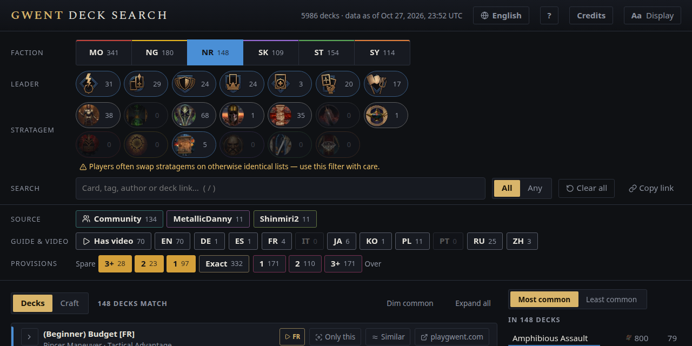

### Read a deck

Click a deck's name to open its card list. **Expand all** opens every deck in the results.

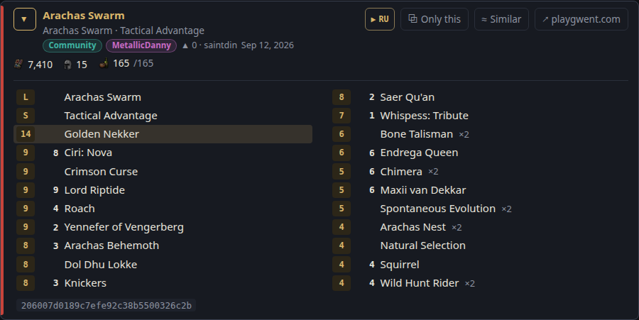

| Part | Meaning |
|---|---|
| **Name** | The deck's name, then its leader · stratagem. |
| **Badges** | Which sources list the deck. Community guides also show votes, author and last update. |
| **Links** | On the right: the guide's language, **▶** for a video, the deck ID and **↗**. On phones they get their own row under the name. |
| **Language** | The language a community guide is written in, as a short code (**EN**, **RU**, **PL**…). Guides that are only filler ("text text text") show none. It says there's real text, not whether it's useful. Hover for the language's name. |
| **▶** | A gameplay video, with the language it's narrated in (e.g. **▶ RU**): from the guide itself, Shinmiri2's or MetallicDanny's list, or Shinmiri2's YouTube channel. Not your language? [It can still help](#common-questions). |
| **Deck ID** | The first 8 characters of the playgwent deck code. Two decks with the same name have different IDs. |
| `≈` | Similar decks: see [`≈` Similar decks](#-similar-decks). |
| **↗** | Opens the deck on playgwent.com in a new tab, ready to import. |
| **Stats** | Scraps · cards · units · provisions used / limit. |
| **Card list** | Provision cost, power (units only) and copies, highest cost first. Cards you searched for are highlighted. Each card name links to its playgwent card page. |

**Videos.** **▶ Has video** in the **Guide & video** filter keeps only decks with a video (about 1,360 of them), and a
language pill keeps decks whose guide or video is in that language: handy for finding guides you can read. A video in
another language can still help: gameplay mostly speaks for itself, and YouTube can translate its subtitles (see [Common
questions](#common-questions)).

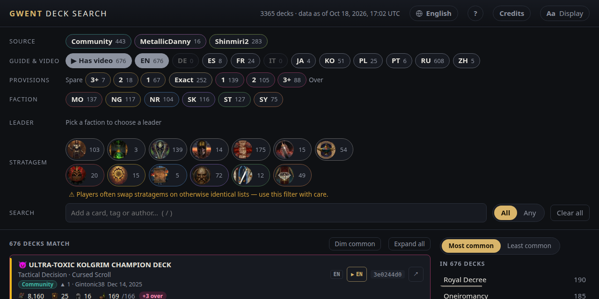

### Dim common

**Dim common** fades the cards that every deck in the results runs, so the cards that make each deck different stand
out. It's most useful with two or three decks open side by side. In a `≈` Similar list it becomes **Show changes**
(see below).

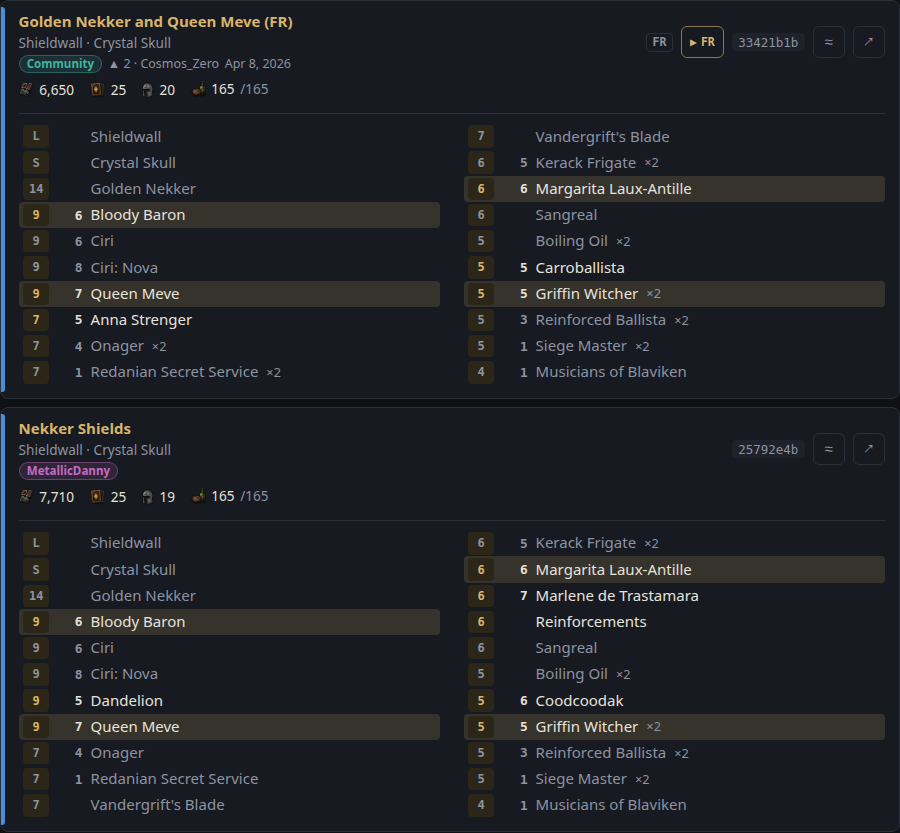

### `≈` Similar decks

Every deck has a `≈` button. It lists the decks with the same leader that fit today's limit (Spare or Exact) and
share at least 15 of its 25 cards (leader and stratagem aside), most in common first, with a badge like **21/25 cards
in common**.

- **Find a playable version of an Over deck**, or **variations of your own**.
- **Compare against it:** the deck itself is listed first, marked **This deck**, whenever its provision step is on. An
  Over deck is hidden until you turn on its own Over step (see [Common questions](#common-questions)); a note above
  the results says so, and its **Show it** button turns that step on.
- **See what each one changed:** **Show changes** compares every deck with **This deck**, listed or not. Open a deck:
  the cards they share are faded, the cards it added are marked `+` (`+1` for an extra copy), and **Swapped out**
  lists the cards it dropped (`−1` for a copy fewer).
- **Widen or narrow it:** your other picks still apply. Turn on an Over step or clear the leader for more decks.
- **Go back:** ✕ on the **Similar to** pill, or Back, returns to the search before.

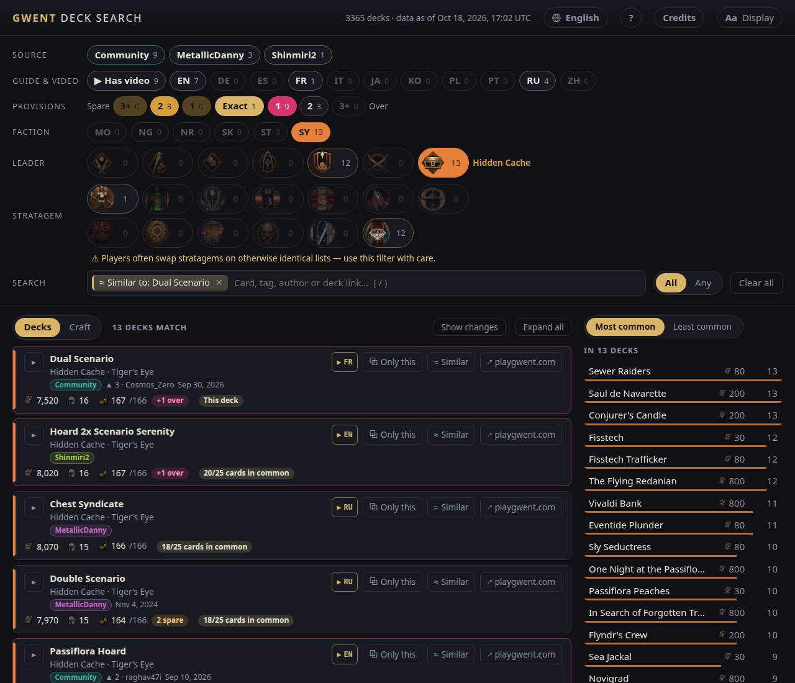

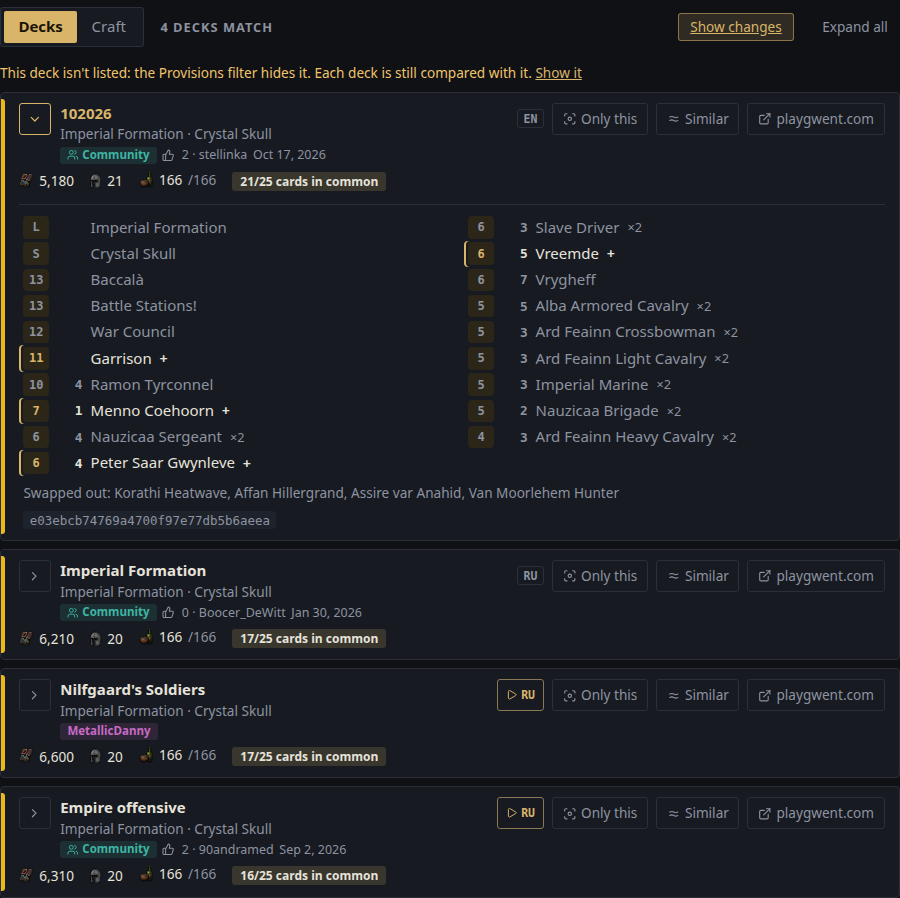

(Building your own copy? `similarMinShared` in `src/config.ts` sets the 15.)

### Craft

**Decks | Craft**, above the results, switches between the deck list and the cards those decks run. The filters
above apply to both, and a shared link keeps the view (`t=craft`).

| Column | What it shows |
|---|---|
| **Decks** | The share of the matching decks that run the card, and how many that is. The list is ordered by it. With no faction picked that's every deck, so a faction card's share counts the other factions' decks too. |
| **Cost** | Scraps to craft it, for the copies most of those decks run (`2 × 80`). |
| **Total** | The running total of the cards you don't have, in list order. |
| **Have it** | Tick a card you own to leave it out of the total. |

**Scraps you have** draws a line where the total passes your scraps, and says how many cards they cover. The line
follows the list's order and never skips ahead to a cheaper card further down.

### Save and share a search

Your filters are part of the page address. Bookmark it, share it, or reload the page and your search is still
there. Deck and card links open in a new tab so you don't lose it.

**Linking to a deck from elsewhere** (a bot, a stream overlay, your own site): add the deck's playgwent.com link,
URL-encoded, as `?deck=`. For example
`https://el8ted.github.io/gwentdecksearch/?deck=https%3A%2F%2Fwww.playgwent.com%2Fen%2Fdecks%2Fguides%2F408411`
opens that deck with its guide and video, then shortens the address to the usual `#d=…`. A deck that isn't in the
list shows its link in Search with a note saying so. This link format is meant to stay; the page still needs
JavaScript, so link previews in chat apps show the plain page.

### Languages

The page comes in the 11 languages playgwent supports. Click the language button (🌐) in the header to change it.
Your choice is remembered; on a first visit the page follows your browser's language.

- **Card names and game terms** (factions, Provisions, Stratagem and so on) are playgwent's official names.
- **The rest of the interface** was machine-translated. Corrections are welcome: see [CONTRIBUTING.md](../CONTRIBUTING.md).
- **Deck names** are shown as their authors wrote them when they're in your language, and machine-translated into
  English otherwise.
- **The Search box** finds cards and tags by their name in your language or in English, and authors by their playgwent
  name.
- **Shared links** keep the language if `?lang=` is in the address, for example `?lang=ru`.

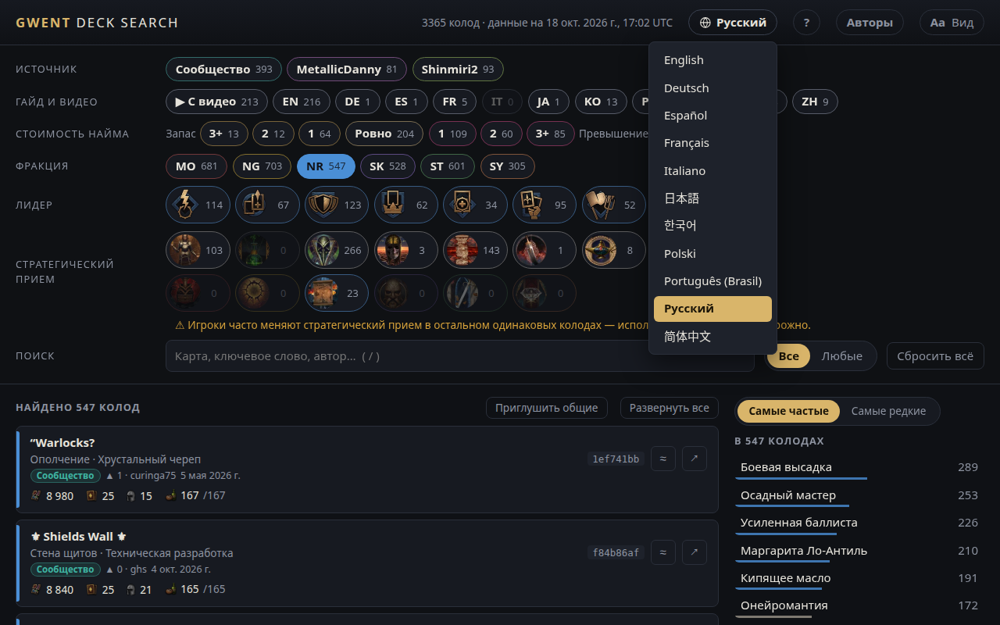

### Display and accessibility

Open **Aa Display** in the header to change:

- **Text size**: 87.5% to 150%. The whole layout scales.
- **Theme**: System, Dark or Light.
- **Contrast**: Standard or High.
- **Colours**: Standard or Colour-blind safe. Colour-blind safe uses the Okabe–Ito palette and adds a faction label
  to each deck, so colour is never the only cue.

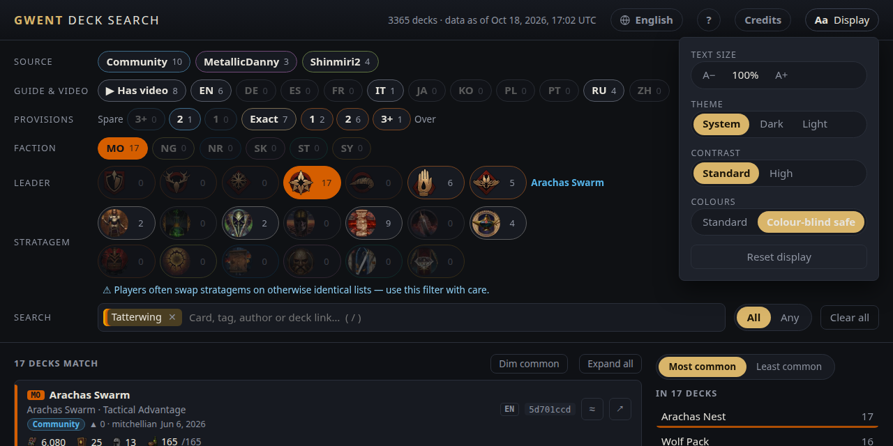

Settings are saved on your device. Filter pills, badges and secondary text meet WCAG AA contrast (4.5:1) in every
theme, contrast and colour setting. Everything works with a keyboard, and animations follow your system's
reduced-motion setting.

### Keyboard shortcuts

Press <kbd>?</kbd> on the page and open **Keyboard shortcuts** for this list.

| Key | Action |
|---|---|
| <kbd>/</kbd> | Jump to the Search box |
| <kbd>[</kbd> | Jump to the filters |
| <kbd>]</kbd> | Jump to card frequency (Most/Least common) |
| <kbd>Shift</kbd>+<kbd>Backspace</kbd> | Clear all (the browser's Back undoes it) |
| <kbd>?</kbd> | Show or hide Help |
| <kbd>↑</kbd> <kbd>↓</kbd> or <kbd>Tab</kbd> | Move through suggestions |
| <kbd>Enter</kbd> | Add the highlighted suggestion |
| <kbd>Backspace</kbd> | Remove the last pick (when the Search box is empty) |
| <kbd>Esc</kbd> | Close suggestions, menus and Help |

Shortcuts work when you aren't typing in a box. On keyboards where <kbd>/</kbd> <kbd>[</kbd> <kbd>]</kbd> are
elsewhere (for example Russian), the keys in the US positions work. Press <kbd>Tab</kbd> at the top of the page for
links that skip to the search, results or card frequency.

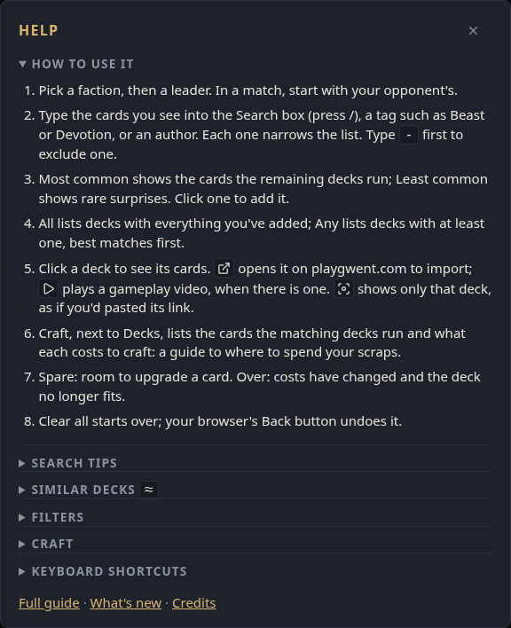

## Common questions

1. **No decks match.** The filters together are too narrow. Remove the last pick you added (✕ on it), or unpick a
   filter. Options that show **0** would leave no decks. **Clear all** starts over.

2. **I can't find the leader.** Pick a faction first; its leaders then appear as icons.

3. **A deck I know is missing.** Only decks from the [sources below](../README.md#where-the-decks-come-from) are
   included, and only recent ones. If a deck should be here, [report
   it](https://github.com/el8ted/gwentdecksearch/issues/new/choose).

4. **A deck disappeared when I used `≈` Similar decks (or the Provisions filter).** `≈` turns on the Spare and Exact
   provision steps, so Over decks, including the one you started from, are hidden. Its pill still counts it: turn on the
   matching Over step (1, 2 or 3+) to bring it back, listed first as **This deck**. The same goes for any Provisions
   selection: a deck shows only if its step is on, or no step is.

5. **A video isn't in my language. Is it still worth a look?** Often, yes. Gameplay mostly speaks for itself: the
   mulligan, the order cards come down, when to pass. YouTube can also show auto-generated subtitles and translate them
   into your language (⚙ settings → Subtitles → Auto-translate), and some videos have AI-dubbed audio in other languages
   (⚙ settings → Audio track). The language code on **▶** only says what the video is narrated in.

6. **A deck says "+N over". Is it broken?** No. Card costs changed after it was published. Swap in a cheaper card before
   you play it.

7. **What does the language code next to a deck mean?** The language its community guide is written in. It only says the
   guide has real text in that language, not whether the text is useful. Guides that are only filler show none.

8. **How current is the data?** The header shows when it was collected, in UTC. Gwent updates land around midnight UTC,
   so you can tell whether the data is from before or after the latest update.

9. **A deck name reads oddly.** Names not written in English are machine-translated. You can [fix
   them](../CONTRIBUTING.md#fixing-deck-name-translations).
